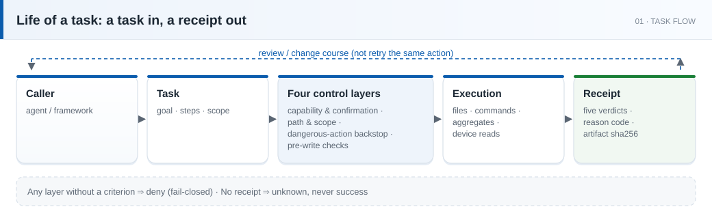
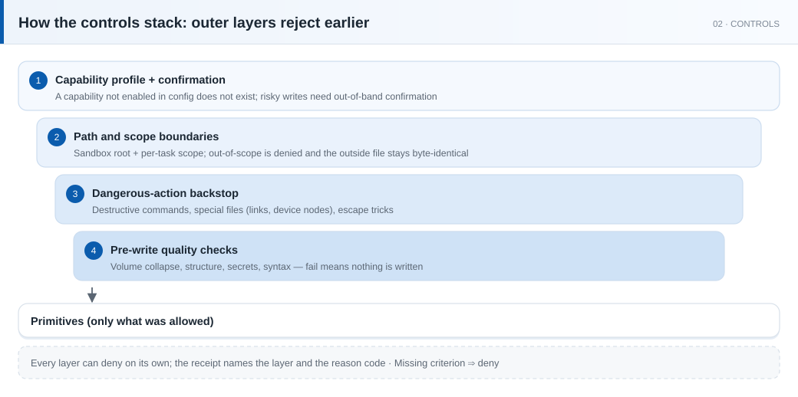
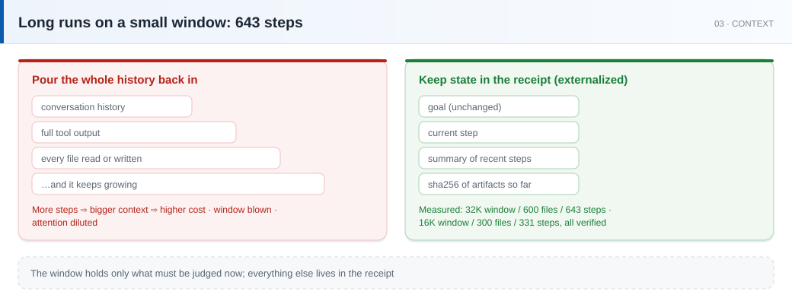
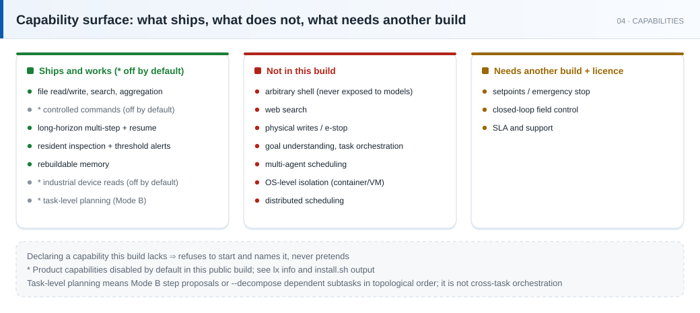

# Lingxi (`lx`) · the execution layer for agents

[](https://github.com/nvwalab/NW-acgent/releases) [](https://github.com/nvwalab/NW-acgent) [](https://github.com/nvwalab/NW-acgent) [](https://www.nvwalab.cn/en/)

> [!NOTE]
> Product version `1.0.0`, internal build number `0.1.7`, contract `2.0` (frozen). The capability set is reported by `lx info`.

> A single 2.6–3.2 MB binary that runs locally, needs no language runtime and no network access.
> Two run modes: **Mode A** takes a task that has already been decomposed and executes it; **Mode B** takes a goal and lets a model propose the steps. Both modes share the same control checks and the same receipt format.

**Current version `1.0.0`** · contract **`2.0`** (frozen) · macOS (Apple Silicon) · macOS (Intel) · Linux x86_64 (fully static) · Raspberry Pi / ARM64 (fully static)

### A 2.6–3.2 MB single binary · no runtime dependency · 643 steps in one long run on a 32K window (Mode B)

<sub>Chinese version → [`README.md`](README.md)</sub>

> [!IMPORTANT]
> Capabilities and the contract are defined by `lx info` / `tools/list`; both track the release, and this document may lag behind.

**Positioning**: Lingxi is the execution layer for agents. It takes work that has already been decided and completes it reliably on a real machine, returning a structured receipt that can be checked offline. It carries out execution, applies the control checks and validates results; goal understanding, cross-task orchestration and multi-agent scheduling belong to the calling agent. Mode A takes a task the caller has already decomposed; Mode B takes one goal, has a model propose each step, and advances according to each receipt (`--decompose` first splits the goal into dependent subtasks and runs them in topological order; off by default). In both modes every step passes the same control checks. To verify: `lx info --config <cfg>` reports the capability set and MCP `tools/list` reports the tool surface.

Each release package is accompanied by a SHA-256 checksum file. **Whether a GPG signature (`.asc` plus public key) is provided depends on the release page**; each `RELEASE.meta` records version / commit / binary hash / signature state / whether tests actually ran.

**Further reading**: [the whitepaper (PDF, in Chinese)](灵犀-白皮书.pdf) — design trade-offs, the safety model, measured readings and falsifiable predictions.

> [!NOTE]
> **Theoretical background**: Lingxi's engineering has a theoretical grounding in [NvwaLab's *Carbon–Silicon Intelligent Symbiosis Theory*](https://www.nvwalab.cn/en/) (Digital Life Theory / Intelligence Theory / Altruism Theory). The theory itself began with observations from a long-running agent engineering practice; those observations became experiments, and the experiments led to frameworks and criteria. The first published paper is [INT-11, *The Nature of Intelligence in Large Language Models: The Triumph of Language as the Highest-Density, Lowest-Entropy Information Carrier*](https://www.nvwalab.cn/en/papers/int-11/); the Lingxi Volume also lists LX-01, *Making Machine Intelligence Ubiquitous: The Lingxi Architecture as an Engineering Record in Extreme Memory and Context Windows* (queued).
> The site is labelled a draft and has not been peer reviewed; the theoretical work is not an empirical guarantee of this software's behaviour. Capabilities and readings remain defined by `lx info` / `tools/list` and each package's `RELEASE.meta`.

> **Language**: this README and `AGENTS.en.md` are in English. The whitepaper and the other in-package handbooks (`QUICKSTART.md`, `LICENSE.md`, `SECURITY.md`, `examples/`) are in Chinese, and the CLI's human-readable summary is printed in Chinese only; machine-readable fields are the same in either language.

---

## Where it fits

It applies to agent hosts, agent frameworks, and the middleware layer that connects a model to real machines. Such systems already provide planning, code generation and tool invocation. What they typically lack is a reliable execution layer. The three problems below cannot be solved by prompt engineering. With no orchestration layer, Mode B applies: one goal is supplied, a model proposes, and Lingxi executes.

| Typical problem | Why prompting does not solve it | How this project handles it | How to verify |
|:--|:--|:--|:--|
| The model reports completion; the file is unchanged | A prompt is a request, not a constraint | Completion requires an **external** check: artifacts carry `sha256`; in Mode B a model self-report is recorded as `SelfReported` and exits 1 | Recompute the artifact's `sha256` and compare it with the receipt |
| A config edit writes outside the intended path (`/etc`) | Models rewrite paths in order to reach the goal | Boundaries are defined in **config** (`sandbox_root` + per-task `resource_scope`) and validated at startup; violations are denied with a reason code | Submit a path outside `resource_scope`; expect `deny` plus a reason code |
| A long-running task cannot be stopped; cost is unbounded | Timeouts cover a single call only | Wall-clock / step / token limits; after `kill -9`, **completed steps are never replayed** and side effects do not repeat | Run a multi-step task with `--max-steps 1` and confirm it stops after step 1; terminate the process and resubmit the same task to confirm nothing is executed twice |

One further principle underlies all of the above: **no receipt means it did not happen.** A missing receipt is recorded as `unknown`, never inferred as success.



---

## Receipt example

`status` takes exactly five values: `ok` / `deny` / `pending` / `unknown` / `degraded`. A zero value is invalid; there is no sixth.

```console
$ lx run examples/task.min.json --config ~/.config/lx/config.json
任务 t-e56811d9d535d8a6 · ok/done · 原因 ok
  步 0 放行 · read_file · cleared_all_gates
  步 1 放行 · write_file · cleared_all_gates
$ echo $?
0
```

The first line printed gives the overall verdict, and each executed step then prints one line. The CLI prints this summary in Chinese, so the output above is reproduced verbatim rather than translated; the receipt below is the machine-readable form and uses the same field names in every language.

> **Reproducing this**: `install.sh` already ran once with the same idempotency key (`quickstart-001`) and wrote a different sample file. So if you follow this section immediately after installing, you will get `status=ok` / `detail=deduped` and `bytes: 22` — that is the previous run being reused, not a rerun, and `deduped` is correct behaviour. To get the numbers below, use an empty `state_root` or change the task's `idempotency_key`.

```json
{
  "task_id": "t-e56811d9d535d8a6",
  "idempotency_key": "quickstart-001",
  "contract_version": "2.0",
  "legacy_task": false,
  "status": "ok",
  "detail": "done",
  "reason": "ok",
  "danger_level": "DL1",
  "steps": [
    {
      "primitive": "read_file",
      "verdict": { "index": 0, "allowed": true, "reason": "cleared_all_gates" },
      "output": { "read_file": { "path": "in.txt", "bytes": 13, "sha256": "8fe7aac41e7f4a9b160c0baa3fb9c22e7aa2c297e8ca20767d1f1b078fec1c54" } },
      "executed": true
    },
    {
      "primitive": "write_file",
      "verdict": { "index": 1, "allowed": true, "reason": "cleared_all_gates" },
      "output": { "write_file": { "path": "out.txt", "bytes": 5, "sha256": "d117fa006ba9208500b2930ce69cbde436c647afa917cb7396a9bc9111a46dd2" } },
      "executed": true
    }
  ],
  "task_hash": "32abe611e46373565f8b1c9fefccf228f2f87dc057826ef618533dc12c155a26",
  "config_sha256": "ca42bf9aef940d0c8b10b1f060a91abfd999927ad4918ef314aab01acff5dceb"
}
```

Four points to note before quoting this receipt:

- `output` is keyed by the **primitive name** (`read_file` / `write_file` here), and each primitive defines its own shape. `read_file` returns `path` / `bytes` / `sha256` only — **never the file's content**.
- **Every artifact carries `bytes` and `sha256`**: `in.txt` is 13 bytes, while `out.txt` holding `done\n` is 5 bytes. Byte counts change with content, which is how a real write is distinguished from a reported one.
- `verdict` is mandatory on every step: `index` / `allowed` / `reason`. When a step is denied, the reason code in `reason` identifies the check that rejected it.
- `task_hash` / `config_sha256` are used for reconciliation: they confirm which task and which configuration version this execution corresponds to. `config_sha256` follows the configuration content, so it differs across machines.

`deny` is not a failure; it is the outcome of a boundary decision. The receipt names the check that fired and the reason code (50 in total), so the caller can adjust the request rather than rephrasing and retrying the same action.

The table below lists five kinds of false success, together with what the receipt returns in each case:

| The false success | What the receipt says instead |
|:--|:--|
| Same `idempotency_key`, changed task, yet `ok/deduped` and the new content never runs | Refused as `idempotency_conflict`, naming both fingerprints |
| `csv_agg op=median` returns `ok/done`, with `op: "median"` in the receipt and the **sum** as the value (1/2/100 to 103) | A value outside the schema enum is refused, and `field_errors` lists the legal set |
| A missing file reported as out-of-scope, read by the model as "I am not allowed here" | Missing is `sandbox_path_not_found`; the two failures never share a code |
| A truncated listing presented as the whole directory | Truncation carries `total` and `truncated` |
| An audit write failed silently, and the receipt still looks fine | `audit_degraded` is set on the receipt |

Two further behaviours concern file safety: `delete` moves the file into `.lxtrash/` inside the sandbox, and this build has **no `unlink` primitive**, so nothing is unrecoverable by default; `truncate` backs up before zeroing. `.lxtrash/` only grows — purging it is the deployment owner's decision, and the tool never reclaims it automatically.

---

## Two run modes

**Mode A (execute)**: the task has already been decomposed by the caller and is submitted as structured JSON. Lingxi only judges, executes and returns a receipt.

**Mode B (autonomous)**: you give one goal; Lingxi calls a model to propose each step, executes it, and decides the next step from the receipt.

| | Mode A · execute | Mode B · autonomous |
|:--|:--|:--|
| Entry point | `lx run <task.json>` · MCP `tools/call` | `lx agent --goal "<goal>"` |
| Input | structured task (missing or empty required fields are rejected) | one natural-language goal |
| Who plans | the caller's agent | Lingxi (model proposes step by step) |
| Model credentials | not required | required: `capabilities.llm=true` plus an OpenAI-compatible endpoint credential |
| Best for | hosts that already have an orchestration layer | teams without one, or anyone wanting to run an end-to-end path first |

Both modes share the same controls and receipts: whoever does the planning, writes still pass the four control layers, artifacts still carry `sha256`, and the receipt format is identical. **Controls are not relaxed by mode** — Mode B only adds a proposal step, and each proposal still passes the same gates. To verify: in Mode B, have the model propose an out-of-scope write and confirm the receipt is `deny` with the same set of reason codes used in Mode A.

Mode B has two ways to advance: step-by-step proposals by default, or `--decompose` to split the goal into dependent subtasks first and run them in topological order (each with its own snapshot and idempotency key). Budget is not part of the task contract and is set at run time: step limit via `--max-steps` (default 20), wall-clock limit via the `LINGXI_AGENT_MAX_WALL_SECS` environment variable (default 2400 s), token budget via `LINGXI_AGENT_TOKEN_BUDGET` (unlimited by default).

A run lands exactly one **completion stamp**, answering *was the goal met* — kept structurally separate from the Mode A receipt, which records *what happened on the machine*:

| Stamp | Issued by | Exit | What it actually establishes |
|:--|:--|--:|:--|
| `Verified` | a check outside the model — `--assert`, or your own acceptance script | **0** | something that is not the model ran, and passed |
| `SelfReported` | the model, after passing its own checklist | **1** | the checks **it chose** passed — not that the goal was met |
| `Unverified` | the verifier, with the reason attached | **1** | verification failed, or no usable check could be produced |

Budget exhaustion, wall-clock timeout, truncation and gateway errors also exit `1`. **By default there is no path to exit `0` that goes through the model's own claim** — you either supply an external check, or pass `--no-verify`. Before it may stamp `SelfReported`, three reconciliations run (plan / task text / checklist, all mechanical comparisons over the actual step log, never another model call); if the task named something to produce and it is not on disk, the run is `Unverified`.

## Integration

For any MCP-capable host. `install.sh` writes a copy with **absolute paths already filled in** to `~/.config/lx/mcp.json`; copy that one:

```json
{ "mcpServers": { "lingxi": { "command": "/Users/<you>/.local/bin/lx",
  "args": ["serve", "--mcp", "--config", "/Users/<you>/.config/lx/config.json"] } } }
```

Paths must be **absolute**: most hosts do not expand `~`, so `~/.local/bin/lx` written verbatim fails to start.

**The authoritative sources are the following two machine-readable interfaces, not this document:**

- `tools/list` — tool names, parameters and descriptions, generated directly from the contract (26 tools plus one built-in `whereami` in the public build);
- `lx info --config <cfg>` — the capabilities actually in force (`primitives[]` / `contract_version` / `limits` / `sandbox_root`).

The contract defines 30 primitives: 27 public (`exposure=public`) and 3 internal (`run_command` is never exposed to a model; `write_setpoint` / `emergency_stop` belong to the physical write face). The public build additionally removes web search at compile time, so `tools/list` reports 26 tools, plus the built-in `whereami`, for 27 in total. `lx info` marks `implemented` per primitive.

Mode A runs one-shot via `lx run`, or through a resident MCP server (stdio or HTTP) driven by the host; `lx info` is for capability checks.

The server processes one request at a time; any other request arriving at the same moment receives `503` immediately, without queueing. Requests are submitted sequentially, and a rejected request can be retried later.

A task is structured JSON with **six required fields** — `contract_version`, `task_type`, `idempotency_key`, `declared_purpose`, `resource_scope`, `steps`. An empty `resource_scope` is treated as *undeclared*, and undeclared tasks are **denied**.

A receipt is JSON plus an artifact manifest; both are defined and versioned by this project's contract.

---

## Reliability

Each row corresponds to a common problem. The third column gives a verification method that can be reproduced independently, without relying on the publisher's claims.

| Typical problem | Handling | Verification |
|:--|:--|:--|
| Reinstalling dependencies on a new machine | Single binary; copy and run (the two Linux builds are fully static, macOS uses the system runtime). No Rust / Python / Node runtime required | On Linux, `file lx` reports `statically linked`; `lx version --json` returns normally |
| The model reports completion but nothing was executed | Completion requires **external evidence**: artifacts carry `sha256` + `bytes` | Recompute the hash; a mismatch means the step was not completed |
| A misconfigured capability degrades silently | An absent capability causes **startup refusal naming the field** (e.g. `physical.write`) | Configure a capability this build does not include; confirm that startup is refused |
| Missing checks lead to a permissive guess | Fail-closed: missing check condition / unreadable ledger / unclear authorization ⇒ deny | Empty the allowlist and run; confirm that everything is denied |
| A terminated process replays completed steps | Advances by completed steps, `detail=recovered`, no duplicated side effects | `kill -9`, resubmit the same task, check for duplicated side effects |
| Duplicate submission of the same task executes twice | Same `idempotency_key` ⇒ `detail=deduped` | Submit the same task twice; compare the two receipts |
| No post-hoc record of decisions and executions | Every decision and execution is written to an **append-only** audit stream | Inspect the audit record; it can be consumed by any log system |
| Long jobs become costlier and less accurate over time (Mode B) | State is externalized; the window holds only what the current decision needs | See the 300 / 600 file long-horizon readings below |
| Environment knowledge must be rebuilt on every run | Memory is derived from receipts, rebuildable, and never changes behaviour or calls a model | Delete the memory directory and rerun; behaviour should be unchanged |
| Inspection requires continuous human attention | Self-scheduled; reports only on **threshold flips**; backlog is re-delivered after process termination | Set a threshold that fires once; confirm that only one report arrives |
| On-site device reading is required, but writing is not permitted | Modbus TCP read points are available, verified to protocol level against a device simulator — **no production PLC has been connected yet**. Setpoint and e-stop writes are **not provided in public builds** | Read one register; then attempt a write and confirm it is denied |

## Design notes

### Control layers (outer layers reject earlier)



Four layers, each able to deny independently. The receipt records the layer that rejected and its reason code. A missing check condition always results in a denial, never a downgrade.

1. **Capability profile, plus out-of-band confirmation.** An ability that is not enabled in config does not exist; high-risk writes require confirmation through a channel the model does not control.
2. **Path and scope boundary.** One sandbox root plus a per-task `resource_scope`. Any escape is denied, and files outside the boundary stay byte-identical.
3. **Dangerous-action backstop.** Destructive commands, special files, and bypass variants (symlinks, hard links, case differences).
4. **Pre-write quality gate.** Abnormal size shrinkage, structure, secrets, syntax. If any check fails, nothing is written.

### Mode B: long runs on a small window



The context window holds only the information the current decision requires: the unchanged goal, the current step, a summary of recent steps, and the `sha256` of artifacts produced so far. Everything else stays in receipts and artifacts. This is **state externalization**, not prompt compression: cost and decision quality do not degrade as the run grows.

The default window is 32K, of which 24,576 tokens are available for input. One task shape (N files rewritten one by one, scripted batching disallowed) measured at three window sizes:

| Window | Files | Steps | Tokens | Result |
|--:|--:|--:|--:|:--|
| 32K | 600 | 643 | 922,320 | Completed, window limit never reached |
| 32K | 300 | 326 | 391,797 | Completed |
| 16K | 300 | 331 | 243,632 | Completed, zero denials |
| 12K | 300 | 8 | 21,492 | A single tool result exceeded the available space; actual usage reported, exit code 1 |

Halving the window to 16K leaves the step count of the same task unchanged (326 → 331) and cuts token consumption by about 38%. No 128K-plus window is required. When the window shrinks far enough that one tool result no longer fits, the run fails by design and reports the exact usage instead of truncating silently or hanging.

---

## Runtime environment

Same binary, same behaviour, from a single-board computer to a rack server. Nothing has to be installed underneath: if the machine can execute an ELF binary and write to a directory, it can run Lingxi.

| Class | Examples |
|:--|:--|
| Single-board computers | Raspberry Pi (64-bit OS), Orange Pi, Radxa, Rock Pi |
| NAS | Synology DSM, QNAP QTS, TrueNAS, OpenMediaVault |
| Industrial PCs, edge gateways | Fanless x86_64 IPC, ARM64 edge gateway |
| Routers, soft routers | OpenWrt on x86_64 or ARM64 — the static build matches OpenWrt's own musl libc |
| Old laptops, thin clients | Any 64-bit Linux machine that still boots |
| Developer boards | Jetson, RK3588 boards (ARM64) |
| VMs, containers | KVM, Proxmox, Docker — none of them required |

Extent of real-hardware verification: the NAS (x86_64) ran the full system harness; the Raspberry Pi (aarch64) ran unpack, install and the installer's self-verification (positive sample `ok`, negative sample denied with the expected reason code, exit code 0). Every class above runs one of the same builds; other devices are not individually tested.

- **Industrial read-only polling**: reads holding registers over Modbus TCP (u16 / f32, four word orders) on its own schedule, checks thresholds, writes to a local outbox before reporting, and raises an alarm only when state flips.
- **File governance on a NAS**: batch rename, archive, dedupe, directory statistics; deletion backs up first.
- **Edge pre-processing**: aggregate CSV / JSON on the device, pass only the summary upstream; raw data stays put.
- **On-prem agent landing point**: a local model (vLLM, Ollama, LM Studio) plus Lingxi; no request has to leave the network.
- **Keeping old hardware useful**: a machine that cannot run a container can still run a 2.6–3.2 MB binary.
- **Scheduled jobs**: cron or a systemd timer starts one run; the idempotency key stops a double run.

The released build reads devices but does not write to them; physical writes are a separate build. One polling process handles one device. Device polling is verified against a Modbus simulator — real protocol, four word orders, exception code `0x02` — not yet against a production PLC.

> [!CAUTION]
> The **physical write face is removed at compile time** in public builds (`RELEASE.meta` reports `physical_write=absent`): device state can be read, but setpoint and emergency-stop writes are unavailable. Enabling it requires a separately authorized build; a config change cannot turn it on.

---

## Installation and self-verification

> [!TIP]
> Verify the checksum before installing: `shasum -a 256 -c lx-1.0.0-<platform>.tar.gz.sha256`; run `gpg --verify` as well when the release page provides `.asc` and a public key.

```bash
shasum -a 256 -c lx-1.0.0-<platform>.tar.gz.sha256   # integrity (included with every package)
gpg --verify lx-1.0.0-<platform>.tar.gz.asc lx-1.0.0-<platform>.tar.gz   # signature (only when the release page provides .asc and a public key)
mkdir -p lx && tar -xzf lx-1.0.0-<platform>.tar.gz -C lx && cd lx
sh install.sh                                        # install and self-verify
```

`install.sh` installs the binary to `~/.local/bin` and writes config to `~/.config/lx`, then immediately runs two samples:
the positive sample must return `ok`, and the negative sample must be denied. The installer uses no `sudo`, requires no
network access, and does not overwrite existing configuration; running it a second time leaves an existing config unchanged.

After installing it prints the capability set actually in force, in four groups, each entry marked `true` / `false`:

- **Enabled**: capabilities that are on, plus the real path of the file boundary;
- **Disabled**: capabilities absent from this build or switched off in config (command-class primitives, networking);
- **LLM**: whether model calls are enabled, and how to use them once they are (Mode B needs model credentials: set `DEEPSEEK_API_KEY` or `OPENCODE_GO_API_KEY`, or point `llm.base_url` at your compatible endpoint);
- **Devices**: device protocol and inspection switches, with how to enable them and where the samples live when off.

It then prints both self-verification results and the installed binary path. The installer's human-readable output is in Chinese, as noted for the CLI summary above.

**Trust your own output rather than this document**: the same binary prints different contents under different configurations, so this README does not reproduce those lines verbatim.

**Self-verification is a mandatory step**: the positive sample must return `ok` and the negative sample must be rejected
by the **expected reason code**. If either result differs, installation aborts and no further steps are performed.

---

## Verified scenarios

| Scenario | Reading |
|:--|:--|
| Batch rewrite of 300 / 600 files (Mode B, real model driving) | 326 / 643 steps all `verified`, no repeated steps, no duplicated side effects |
| Resume after a terminated process | Completed steps are never replayed, `detail=recovered` |
| Escape attempts: out-of-scope writes / symlinks / hardlinks / replaced parent directories | All denied by these checks; files outside the boundary stay byte-identical; reason codes are diagnostic |
| Industrial device read-only inspection | Modbus TCP **device simulator** (real protocol, four word orders, exception code 0x02 handled); **no production PLC connected yet**; the write face refuses to start by design |
| Clean-machine install | Unpack → install → positive sample returns `ok` and the negative sample is denied with the expected reason code; run on macOS / Linux / Raspberry Pi |

## Readings and verification

This section has two groups. Readings under **reproducible on your machine** come with a command. Readings under **executed by the publisher** state the measurement method and date, and say why they cannot be recomputed locally. When two readings exist for the same metric, both are listed and they are never combined.

### Reproducible on your machine

- **Package integrity**: after unpacking, run `sha256sum -c <package>.sha256` and compare with the value listed on the release page.
- **Per-package test status**: read `RELEASE.meta` inside the package. The fields `tests` / `tests_skipped` / `write_face_assert` / `physical_write` / `signed` record what that package actually executed and what it skipped. The four packages differ; each package's own `RELEASE.meta` is authoritative.
- **Install and self-verification**: run `install.sh`. The positive sample must return `ok` and the negative sample must be denied with the expected reason code; if either differs, installation aborts.
- **Capability set**: `lx info --config <cfg>` prints the primitives in force, the contract version, the limits and the sandbox root.

### Executed by the publisher

Recomputing the readings below requires the source repository and a build environment. Public packages contain no source, so only the method and the date are given.

- **Tests** (as of 2026-11-04): `833` unit/integration tests pass, `0` failures; a further `2` tests require real model credentials and are ignored by default. Measurement basis: built with the `agent` capability, `cargo test --workspace --features agent -- --list` counts 835, minus the 2 ignored by default.
- **Contract reconciliation** (field-by-field, caller's perspective): **125 / 125 pass**, **3 SKIP** — SKIP means *this build has no write face / e-stop / web search*, and **SKIP is not counted as a pass**.
- **System harness**: fault injection — escape-class attacks (scope escapes, symlinks, hardlinks, replaced parent directories, races) are all denied by these checks, and files outside the boundary stay byte-identical. Release hardening: **17/17 + 1 SKIP on real hardware**, and the same suite runs **18/18 on the build machine** (the two readings are recorded separately and never combined).
- **Real-hardware harness**: the `aarch64-apple-darwin` package ran the full system harness natively on the build machine; the `x86_64-unknown-linux-musl` package ran the same suite on an x86_64 Linux machine. `x86_64-apple-darwin` and `aarch64-unknown-linux-musl` are cross-builds; checks not executed are recorded in each package's `RELEASE.meta`.
- **Terminal-Bench 1.0** (241 tasks; graders written by the task authors, checking real container state): **143 / 241 = 59.3%**.
  Measured **2026-10-28** in **Mode B** (`lx agent --goal`, without `--decompose`), driven by **DeepSeek V4.1 Flash**. The model proposes each step; Lingxi controls, executes and verifies — so the reading reflects the model-plus-Lingxi combination, and a different model will produce a different reading. Per-task records (241 rows, one per task, with difficulty, category, pass/fail, stop reason and elapsed time) ship with this repository: [`bench/trials.csv`](bench/trials.csv). Version 1.0 has since been superseded by 4.0, so results should not be compared across versions; each task was attempted once, without external checks.

---

## Not applicable

> If a requirement falls into any row below, this project is not applicable. This section is best read before the remaining chapters.



| Requirement | Boundary of this project | Alternative |
|:--|:--|:--|
| A model executing shell commands directly | **Not provided.** Command-class operations go only through `run_command_structured(program, args, cwd)`, where `program` must be an absolute path on the allowlist | Container / sandbox VM |
| Web retrieval | Public builds ship without search capability | The caller obtains the facts and puts them in the task |
| Writing to real devices (setpoints / e-stops) | Public builds provide read points only | A separate build with separate authorization |
| Multi-agent orchestration, cross-machine scheduling | **Not provided.** One instance, one process, one task chain; dividing work among several agents and scheduling them is the caller's responsibility. `--decompose` in Mode B only splits one goal into dependent subtasks and runs them in topological order — it is not multi-agent collaboration | Your existing orchestration layer |
| Container-level isolation | Provides path-level and command-level boundaries; not equivalent to a container or sandbox VM | Deploy inside a container |
| Multi-machine / distributed scheduling | Single-machine, local-first, offline; no resident cloud service required | An existing scheduler |

---

## Specifications

| Item | Value |
|:--|:--|
| Package contents | one static binary `lx` · `RELEASE.meta` · `QUICKSTART.md` · `examples/` · `AGENTS.md` · `AGENTS.en.md` · `mcp.json` · `install.sh` · `LICENSE.md` · `SECURITY.md` · `灵犀-白皮书.pdf` (whitepaper) |
| Platforms | `aarch64-apple-darwin` · `x86_64-apple-darwin` · `x86_64-unknown-linux-musl` · `aarch64-unknown-linux-musl` (the two Linux builds are fully static; macOS uses the system runtime) |
| Size | binary 2.6–3.2 MB (decimal, per platform); download 1.6–1.9 MB including the whitepaper PDF (per platform) |
| Memory | idle RSS varies by platform: ≈ 2 MB on macOS arm64 (2,016 KB) and ≈ 5.5 MB on macOS x86_64 (5,500,928 B measured, `lx --help`); ~11 MB for a single task (measured on an earlier version on x86_64 Linux; not re-measured for 1.0.0) |
| Context window | 32K by default (24,576 available for input, 8,192 reserved for output); a 16K window still completes long runs |
| Execution model | Single instance; the server handles one request at a time and returns `503` for any other request (no queueing) |
| Contract | `2.0` (frozen): 30 primitives / 50 reason codes / task · receipt · artifact manifest |
| Interfaces | MCP stdio, MCP HTTP, this project's own envelope; five verdict words, a zero value is invalid |

---

## License & security

- **This project does not use an open-source license.** It is distributed as binaries, with **no source code**. The free-use scope (individuals / non-profit / education / government agencies for non-military use / organizations with annual revenue below ¥50M), commercial terms and prohibited uses are set out in `LICENSE.md` inside the package.
- **Physical write capability is not included in public builds** (it is removed at compile time). Using it requires a separately authorized build.
- **Security vulnerabilities should not be disclosed publicly in detail.** `SECURITY.md` in the package lists cases that look like defects but are by design, and gives a reporting route that does not publish the details.

---

## Next steps

1. **Download a release package** ([Releases](https://github.com/nvwalab/NW-acgent/releases)) and follow the installation steps above; the self-verification reports the capabilities actually in force.
2. **Connect an agent host**: use the configuration snippet in `mcp.json`, then inspect the tool surface via `tools/list`.
3. **Integrate directly**: read `QUICKSTART.md` and `examples/` (including **negative samples**, which show the shape of a denial receipt); Mode B credentials, exit codes and `--assert` are in the same `QUICKSTART.md`.
4. **Require a build with the physical write face / a commercial license / support**: this requires a **separate build** and cannot be obtained by changing configuration; submit an issue on the release page.

> This repository holds outward-facing documents only: both READMEs, the whitepaper PDF and the figures. It contains no source code and no binaries — release packages are on the Releases page. Capabilities and contract are defined by `lx info` and `tools/list`; those track the release, while this page may lag behind.
