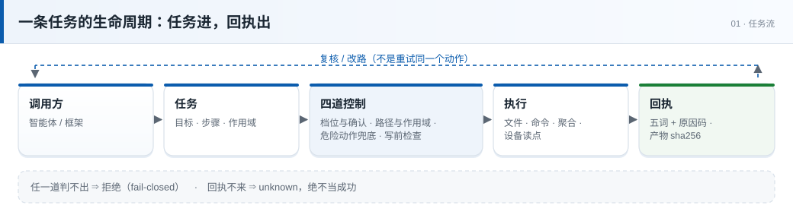
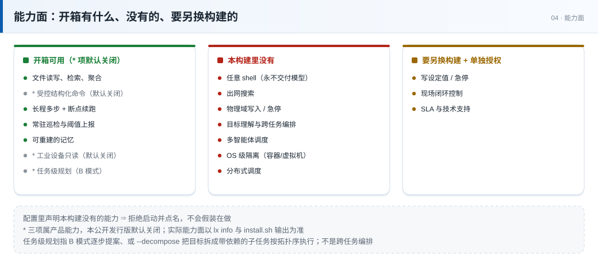

# 灵犀（Lingxi）· 智能体的执行层

[](https://github.com/nvwalab/NW-acgent/releases) [](https://github.com/nvwalab/NW-acgent) [](https://github.com/nvwalab/NW-acgent)

> [!NOTE]
> 产品版本 `1.0.0`，内部构建号 `0.1.7`，契约 `2.0`（已冻结）。能力面以 `lx info` 为准。

> 单文件二进制，体积 2.6–3.2 MB，本地运行，不需要语言运行时，也不需要联网。
> 两种运行模式：**A 模式**接收已拆好的任务并执行；**B 模式**接收一个目标，由模型逐步提案并执行。两种模式共用同一套控制判定与回执格式。

**当前版本 `1.0.0`** · 契约 **`2.0`**（已冻结）· macOS（Apple Silicon） · macOS（Intel） · Linux x86_64（全静态） · 树莓派 / ARM64（全静态）

### 单文件 2.6–3.2 MB · 无运行时依赖 · 32K 窗口实测 643 步（B 模式）

> **English** — Lingxi is the execution layer for agents. A single 2.6–3.2 MB binary takes a structured task, passes it through four control layers (capability, path, dangerous action, pre-write quality), executes it, and returns a receipt that can be verified offline. Local-first: no runtime, no network, and no model except in Mode B. Every artifact carries a SHA-256, and a run is stamped `Verified` only when something other than the model did the checking.
>
> **[Full English README →](README.en.md)**

> [!IMPORTANT]
> 能力与契约以 `lx info` / `tools/list` 为准；二者随版本更新，本文档可能滞后。

**定位**：灵犀是智能体的执行层，负责把已经决定要做的事在一台真实机器上可靠地做完，并交回可离线核对的结构化回执。它承担执行、控制判定与结果校验；目标理解、跨任务编排与多智能体调度由调用方的智能体负责。A 模式接收调用方已拆好的任务；B 模式接收一个目标，由模型逐步提案、按每步回执决定下一步（加 `--decompose` 可先拆成带依赖的子任务，按拓扑序执行，默认关闭）。两种模式下每一步都过同一套控制判定。验证方式：`lx info --config <配置>` 给出能力面，MCP `tools/list` 给出工具面。

发布包随附 SHA-256 校验文件；**是否提供 GPG 签名（`.asc` 与公钥）以发布页标注为准**，包内 `RELEASE.meta` 同时记录版本 / 提交 / 二进制哈希 / 签名状态 / 测试是否实际执行。

**延伸阅读**：[灵犀白皮书（PDF）](灵犀-白皮书.pdf) —— 设计取舍、安全模型、验证读数与可检验预测。

---

## 适用场景

适用于智能体宿主、智能体框架，以及将模型接入真实机器的中间层。这类系统通常已具备规划、代码生成与工具调用能力，缺少的是可靠的执行层——以下三类问题无法通过提示词工程解决。若尚无编排层，可直接用 B 模式：给一个目标，由模型提案、灵犀执行。

| 典型问题 | 提示词为何无效 | 本项目的处理 | 验证方法 |
|:--|:--|:--|:--|
| 模型报告完成，实际文件未变更 | 提示词是请求，不构成约束 | 完成需**外部校验**确认：产物带 `sha256`；B 模式下模型自称完成记为 `SelfReported`，退出码 1 | 对产物自行复算 `sha256`，与回执比对 |
| 修改配置时越界写入 `/etc` | 模型会改写路径以完成目标 | 边界定义在**配置**中（`sandbox_root` + 逐任务 `resource_scope`），启动时校验；越界即拒，回执附原因码 | 提交一个 `resource_scope` 之外的路径，确认 `deny` + 原因码 |
| 长时间运行无法终止，成本失控 | 超时只覆盖单次调用 | 运行时长 / 步数 / token 三重上限；`kill -9` 后**已完成的步不重放**，副作用不重复发生 | 以 `--max-steps 1` 跑一个多步任务，确认第 1 步后停止；终止进程后重投同一任务，确认不重复执行 |

此外有一条更基本的原则：**未收到回执即视为未发生**。回执缺失一律按 `unknown` 处理，不推断成功——这是本项目对调用方最基本的承诺。

**不适用于**：需要任意 shell 命令执行、联网检索、真实设备写入、多智能体编排或容器级隔离的场景。明细与替代方案见下文「不适用场景」。



---

## 回执示例

```console
$ lx run examples/task.min.json --config ~/.config/lx/config.json
任务 t-e56811d9d535d8a6 · ok/done · 原因 ok
  步 0 放行 · read_file · cleared_all_gates
  步 1 放行 · write_file · cleared_all_gates
$ echo $?
0
```

终端摘要中，第一行给出整体判定，随后每个执行步骤各一行。`status` 仅有五个取值：`ok` / `deny` / `pending` / `unknown` / `degraded`。零值非法，无第六种取值。

以下为同一任务的**完整回执**（`examples/task.min.json`，沙箱内 `in.txt` 内容为 `hello lingxi`，未删节、未改写）：

> **复现提示**：`install.sh` 已用同一个幂等键（`quickstart-001`）跑过一次，它的样例文件内容也不同。所以装完立刻照本节复现，会得到 `status=ok` / `detail=deduped` 和 `bytes: 22`——那是**复用上次结果**，不是重跑，`deduped` 本身是正确行为。要拿到本节这些数值，换一个空的 `state_root`，或改掉任务里的 `idempotency_key`。

```json
{
  "task_id": "t-e56811d9d535d8a6",
  "idempotency_key": "quickstart-001",
  "contract_version": "2.0",
  "legacy_task": false,
  "status": "ok",
  "detail": "done",
  "reason": "ok",
  "danger_level": "DL1",
  "steps": [
    {
      "primitive": "read_file",
      "verdict": { "index": 0, "allowed": true, "reason": "cleared_all_gates" },
      "output": { "read_file": { "path": "in.txt", "bytes": 13, "sha256": "8fe7aac41e7f4a9b160c0baa3fb9c22e7aa2c297e8ca20767d1f1b078fec1c54" } },
      "executed": true
    },
    {
      "primitive": "write_file",
      "verdict": { "index": 1, "allowed": true, "reason": "cleared_all_gates" },
      "output": { "write_file": { "path": "out.txt", "bytes": 5, "sha256": "d117fa006ba9208500b2930ce69cbde436c647afa917cb7396a9bc9111a46dd2" } },
      "executed": true
    }
  ],
  "task_hash": "32abe611e46373565f8b1c9fefccf228f2f87dc057826ef618533dc12c155a26",
  "config_sha256": "ca42bf9aef940d0c8b10b1f060a91abfd999927ad4918ef314aab01acff5dceb"
}
```

引用前需注意四点：

- **`output` 的外层键为原语名**（此处为 `read_file` / `write_file`），内层字段由该原语定义。`read_file` 仅返回 `path` / `bytes` / `sha256`，**不返回文件内容**。
- **每个产物都给 `bytes` 与 `sha256`**：`in.txt` 为 13 字节，`out.txt` 写入 `done\n` 为 5 字节——字节数随内容变化，可用于核对写入是否真的发生。
- **`verdict` 为必填对象**：`index` / `allowed` / `reason`。被拒时依据 `reason` 中的原因码定位是哪项检查拦下的。
- **`task_hash` / `config_sha256` 用于对账**：确认本次执行对应的任务与配置版本。`config_sha256` 随配置文件内容变化，换机器后数值不同属正常。

`deny` 不是故障，而是边界判定的结果。回执中写明触发的检查项与原因码（共 50 个），调用方应据此调整请求，而非改写后重试同一动作。

下表列出五类假成功，以及回执在同样情形下的实际返回：

| 假成功 | 回执实际怎么说 |
|:--|:--|
| 同一个 `idempotency_key` 换了任务内容，却回 `ok/deduped`，新内容一步没跑 | 拒绝并报 `idempotency_conflict`，点名两个指纹 |
| `csv_agg op=median` 回 `ok/done`，`op` 写着 median，`value` 却是 sum 的结果（1/2/100 得 103） | 取值域外的参数直接拒，`field_errors` 列出合法值 |
| 文件不存在被当成「越界」，模型读成「我不许读这里」 | 不存在就是不存在，两类失败不共用一个码 |
| 列表被截断，却当成整个目录 | 带 `total` 与 `truncated` |
| 审计写失败，回执看不出来 | 回执上有 `audit_degraded` |

另有两条与文件安全相关：`delete` 将文件移入沙箱内 `.lxtrash/`，本版**没有 `unlink` 原语**，默认不存在不可恢复的删除；`truncate` 先备份再清零。`.lxtrash/` 只增不减，清理由部署方决定，工具本身不自动回收。

---

## 两种运行模式

**A 模式（执行）**：任务已由调用方拆好，以结构化 JSON 提交。灵犀只做判定、执行、回执。

**B 模式（自主）**：只给一个目标，灵犀调用模型逐步提案，每步执行后按回执决定下一步。

| | A 模式 · 执行 | B 模式 · 自主 |
|:--|:--|:--|
| 入口 | `lx run <任务.json>` · MCP `tools/call` | `lx agent --goal "<目标>"` |
| 输入 | 结构化任务（必填字段缺失或为空即拒） | 一个自然语言目标 |
| 谁做规划 | 调用方的智能体 | 灵犀（模型逐步提案） |
| 需要模型凭据 | 否 | 是：配置 `capabilities.llm=true` + OpenAI 兼容端点凭据 |
| 适合 | 已有编排层的宿主，把灵犀当执行层 | 没有编排层，或想先跑通一条完整链路 |

两种模式共用同一套控制与回执：无论谁做规划，写入都要过四道控制，产物都带 `sha256`，回执格式相同。**控制不因模式而放松**——B 模式只是多了「提案」这一环，提案本身仍要过同一套判定。验证：在 B 模式下让模型提交一个越界提案，确认回执为 `deny` 且原因码与 A 模式同一套。

B 模式有两种推进方式：默认逐步提案；加 `--decompose` 先把目标拆成带依赖的子任务，再按拓扑序逐个执行（各自独立快照与幂等键）。预算不属于任务契约，由运行参数给定：步数上限 `--max-steps`（默认 20），运行时长上限取环境变量 `LINGXI_AGENT_MAX_WALL_SECS`（默认 2400 秒），token 预算取 `LINGXI_AGENT_TOKEN_BUDGET`（默认不限）。

一次运行只落一枚**完成印章**，回答「目标有没有达成」——与 A 模式的回执（记录机器上发生了什么）在数据结构上是分开的：

| 印章 | 谁盖的 | 退出码 | 实际证明了什么 |
|:--|:--|--:|:--|
| `Verified` | 模型之外的检查（`--assert` 或你自己的验收脚本） | **0** | 有一个不是模型的东西真的跑了，并通过 |
| `SelfReported` | 模型自己，通过了它自列的清单 | **1** | **它自己选的**检查都过了，不等于目标达成 |
| `Unverified` | 校验判未通过，附原因 | **1** | 验证失败，或产不出可用判据 |

预算耗尽、运行时长到点、输出截断、网关错误同样返回 `1`。**默认情况下，模型自称完成不会返回退出码 `0`**——要么给外部判据，要么显式 `--no-verify`。记 `SelfReported` 之前还有三道机械对账（计划 / 任务描述 / 自评验收，均对真实步骤日志比对，不再调一次模型）；任务描述中点名要产出的东西磁盘上不存在，则直接判 `Unverified`。

## 接入方式

接入任何支持 MCP 的宿主。`install.sh` 会在 `~/.config/lx/mcp.json` 生成一份**填好绝对路径**的配置，直接抄那一份：

```json
{ "mcpServers": { "lingxi": { "command": "/Users/<你的用户名>/.local/bin/lx",
  "args": ["serve", "--mcp", "--config", "/Users/<你的用户名>/.config/lx/config.json"] } } }
```

路径必须是**绝对路径**：多数宿主不展开 `~`，原样写 `~/.local/bin/lx` 会启动失败。

**权威事实源为以下两处机器可读接口，而非本文档**：

- `tools/list` —— 工具名、参数与说明，直接来自契约（公开发行版 26 个工具 + 1 个内置工具 `whereami`）；
- `lx info --config <配置>` —— 实际生效的能力面（`primitives[]` / `contract_version` / `limits` / `sandbox_root`）。

契约共定义 30 个原语：27 个对外（`exposure=public`），3 个内部（`run_command` 设计上不向模型提供；`write_setpoint` / `emergency_stop` 属物理域写入）。公开发行版在编译期再裁掉联网检索，因此 `tools/list` 列出 26 个工具，加内置的 `whereami` 共 27 个。`lx info` 的 `primitives[]` 逐项标明 `implemented`。

A 模式经 `lx run` 一次性调用，或经常驻 MCP（stdio 或 HTTP）由宿主调用；`lx info` 用于能力自查。

服务端同时只处理 1 个请求；同一时刻到达的其余请求直接返回 `503`，不排队。调用方应串行提交，被拒的请求稍后重试。

任务为结构化 JSON，**六项必填**：`contract_version` / `task_type` / `idempotency_key` / `declared_purpose` / `resource_scope` / `steps`。`resource_scope` 为空视为未声明，**拒绝执行**。

回执为 JSON 与产物清单，二者均由本项目契约定义并版本化。

---

## 可靠性依据

下表每行对应一类常见问题。第三列为验证方法，可独立复现，无需依赖发布方声明。

| 典型问题 | 处理方式 | 验证方法 |
|:--|:--|:--|
| 更换机器后需重新安装依赖 | 单文件，复制即可运行（Linux 两种为全静态构建，macOS 使用系统自带运行库）；不依赖 Rust / Python / Node | Linux 上 `file lx` 显示 `statically linked`；`lx version --json` 正常返回 |
| 模型报告完成，实际未执行 | 完成需**外部校验**确认：产物带 `sha256` + `bytes` | 自行复算哈希；不一致即未完成 |
| 配置错误时静默降级 | 能力未编入时**拒绝启动并指明字段**（如 `physical.write`） | 配置本构建未包含的能力，确认是否拒绝启动 |
| 检查条件缺失时推测放行 | fail-closed：检查条件缺失 / 台账不可读 / 授权不明 ⇒ 一律拒绝 | 清空白名单后执行，确认全部拒绝 |
| 进程中断后重复执行已完成步骤 | 按已完成步数推进，`detail=recovered`，无重复副作用 | `kill -9` 后重投同一任务，核对副作用是否重复 |
| 同一任务重复提交导致重复执行 | 同一 `idempotency_key` ⇒ `detail=deduped` | 同一任务提交两次，比对两份回执 |
| 事后无法追溯判定与执行记录 | 每次判定与执行均写入**只追加**审计记录 | 查阅审计记录；可接入任意日志系统 |
| 长任务成本上升、输出质量下降（B 模式） | 状态外置，上下文仅保留当前判定所需信息 | 参见下文 300 / 600 文件的长程读数 |
| 每次运行需重新建立环境认知 | 记忆由回执提炼，可重建，不改变行为、不调用模型 | 删除记忆目录后重跑，行为应保持一致 |
| 巡检需要人工值守 | 自调度；仅在**阈值翻转**时上报；进程终止后积压重投 | 设置一个会触发一次的阈值，确认仅上报一次 |
| 现场需读取设备，但不允许写入 | Modbus TCP 读点可用，验证至协议级与设备模拟器——**尚未接入真实产线 PLC**；写设定值与急停**不在公开发行版中提供** | 读取一个寄存器；再尝试写入，确认被拒 |

---

## 设计要点

### 控制层级（越靠外越早拒绝）


四道控制均可**独立拒绝**，回执中记录触发层级与原因码；检查条件缺失一律拒绝，不做降级放行。

1. **权限级别 + 人工确认**：配置中未开启的能力视为不存在；高危写操作需带外确认。
2. **路径与作用域边界**：沙箱根 + 逐任务作用域；越界即拒，界外文件逐字节不变。
3. **危险动作兜底**：破坏性命令、特殊文件、逃逸写法（符号链接 / 硬链接 / 大小写差异）。
4. **写前质量检查**：体积塌缩、结构、密钥、语法；任一项检查不通过则不写入磁盘。

### B 模式：小窗口下的长程执行


上下文窗口中仅保留当前判定所需的信息：不变的目标、当前步骤、最近若干步骤的摘要，以及已产出物的 `sha256`。其余信息保留在回执与产物中。该设计并非文本压缩技巧，而是**状态外置**——长任务的成本与判断质量不随上下文增长而劣化。

默认窗口 32K，其中 24,576 token 可用于输入。同一任务形态（N 个文件逐个改写，禁用脚本批量）在三种窗口下的实测：

| 窗口 | 文件数 | 步数 | 令牌 | 结果 |
|--:|--:|--:|--:|:--|
| 32K | 600 | 643 | 922,320 | 完成，未触发窗口超限 |
| 32K | 300 | 326 | 391,797 | 完成 |
| 16K | 300 | 331 | 243,632 | 完成，零拒绝 |
| 12K | 300 | 8 | 21,492 | 单条工具结果超出可用空间，报出实际占用后退出码 1 |

窗口减半到 16K，同一任务步数不变（326 → 331），令牌消耗下降约 38%——不需要 128K 以上的大窗口。继续缩小到单条工具结果装不下时，运行按设计失败并报出精确占用，不静默截断、不挂死。

## 运行环境

同一份二进制，同一套行为——从单板机到机架服务器。底下不用先装任何东西：能执行 ELF 二进制、能写目录，就能跑。

| 一类设备 | 例子 |
|:--|:--|
| 单板机 | 树莓派（64 位系统）、香橙派、Radxa、Rock Pi |
| NAS | 群晖 DSM、威联通 QTS、TrueNAS、OpenMediaVault |
| 工控机 / 边缘网关 | 无风扇 x86_64 工控机、ARM64 边缘网关 |
| 路由器 / 软路由 | OpenWrt（x86_64 或 ARM64）——静态构建与它用的 musl 同源 |
| 旧笔记本 / 瘦客户端 | 任何还能开机的 64 位 Linux 机器 |
| 开发板 | Jetson、RK3588 系列（ARM64） |
| 虚拟机 / 容器 | KVM、Proxmox、Docker，但都不是必需 |

真机验证程度：NAS（x86_64）执行了完整系统台架；树莓派（aarch64）执行了解包安装与安装脚本自验（正向样例 `ok`、拒绝样例按预期原因码被拒，退出码 0）。上表各类设备使用的是同一份二进制，其余机型未逐台测试。

- **工业巡检**：Modbus TCP 读保持寄存器（u16 / f32，四种字序），自带节拍采集、阈值判定；先落盘再上报，只在状态翻转时告警
- **文件治理**：批量改名、归档、去重、目录统计；删除前先备份
- **边缘汇总**：在设备侧汇总 CSV / JSON，只把摘要往上送，原始数据留在本地
- **内网落点**：本地模型（vLLM、Ollama、LM Studio）加灵犀，整个链路不必离开内网
- **旧机续用**：跑不动容器的机器，仍然跑得动一个 2.6–3.2 MB 的二进制
- **定时任务**：cron 或 systemd timer 拉起单次任务；幂等键防止重复执行

公开发行版**能读设备，不写设备**——物理域写入是另一个构建；单个巡检进程对应单台设备。设备巡检目前验证到 Modbus 模拟器（真实协议、四种字序、异常码 `0x02`），尚未接入真实产线 PLC。

> [!CAUTION]
> 对外发行版的物理域**写面已在编译期裁剪**（包内 `RELEASE.meta` 实测 `physical_write=absent`）：可读取设备状态，不能下发设定值或急停。需要写面须另行授权并单独构建，改配置无法开启。

## 安装与自验

> [!TIP]
> 安装前先校验随包哈希：`shasum -a 256 -c lx-1.0.0-<平台>.tar.gz.sha256`；发布页提供 `.asc` 与公钥时，再执行 `gpg --verify`。

```bash
shasum -a 256 -c lx-1.0.0-<平台>.tar.gz.sha256   # 校验哈希（每个包都随附）
gpg --verify lx-1.0.0-<平台>.tar.gz.asc lx-1.0.0-<平台>.tar.gz   # 验证签名（发布页提供 .asc 与公钥时执行）
mkdir -p lx && tar -xzf lx-1.0.0-<平台>.tar.gz -C lx && cd lx
sh install.sh                                      # 安装并执行自验
```

`install.sh` 将二进制安装至 `~/.local/bin`，配置写入 `~/.config/lx`，随后立即执行两个样例：正向样例须返回 `ok`，拒绝样例须按预期原因码被拒。安装过程不使用 `sudo`、不联网、不覆盖已有配置（重复执行第二次时，已存在的配置保持原样）。

安装完成后打印**实际生效**的能力面，分四类，每项标 `true` / `false`：

- **能**：已开启的能力，以及文件边界的实际路径；
- **不能**：这个构建里没有、或配置里关掉的能力（命令类原语、联网）；
- **LLM**：模型调用是否开启，以及开启后怎么用（B 模式需要模型凭据：设 `DEEPSEEK_API_KEY` 或 `OPENCODE_GO_API_KEY`，或用 `llm.base_url` 指向你的兼容端点）；
- **设备**：设备协议与巡检的开关状态，未开启时给出开启方式与样例位置。

随后打印自验结果（正向样例 `ok`、拒绝样例按预期原因码被拒），最后给出二进制落点。

**以你机器上的实际输出为准**：这只描述输出的形状，不复制数值——同一份二进制在不同配置下这四类内容不同，复制了就会与你的实际状态不符。想看真实输出，跑一次 `install.sh`。

**该自验为强制环节**：正向样例须返回 `ok`，拒绝样例须由**预期原因码**拒绝；任一不符即中止安装，不进入后续步骤。

如需立即确认边界是否生效：

```bash
~/.local/bin/lx info --config ~/.config/lx/config.json   # 实际生效的能力面
```

---

## 已验证场景

| 场景 | 读数 |
|:--|:--|
| 批量修改 300 / 600 个文件（B 模式，真实模型驱动） | 326 / 643 步全 `verified`，无重复步、无重复副作用 |
| 断点续跑（进程被终止） | 已完成的步不重放，`detail=recovered` |
| 越界写 / 符号链接 / 硬链接穿透 / 父目录被替换 | 全部按检查条件拒绝，界外文件**逐字节不变**；拒绝码可诊断 |
| 工业设备只读巡检 | Modbus TCP **设备模拟器**（真实协议、四种字序、异常码 0x02 处理）；**尚未接入真实产线 PLC**，写入面按设计拒绝启动 |
| 全新环境安装 | 解包 → 安装 → 正向样例返回 `ok`、拒绝样例按预期原因码被拒；macOS / Linux / 树莓派各执行一次 |

---

## 读数与验证

本节分两组：**读者可自行复算**的，给出复算命令；**由发布方执行、读者无法在本机复算**的，给出测量方法与日期，并注明不可复算的原因。同一指标存在两种口径时分别列出，不合并计算。

### 读者可自行复算

- **发布包完整性**：解包后执行 `sha256sum -c <包名>.sha256`，与发布页列出的值比对。
- **逐包测试状态**：读取包内 `RELEASE.meta`，字段 `tests` / `tests_skipped` / `write_face_assert` / `physical_write` / `signed` 记录该包实际执行了什么、跳过了什么。四个包的记录不同，以各自 `RELEASE.meta` 为准。
- **安装与自验**：执行 `install.sh`，正向样例须返回 `ok`、拒绝样例须按预期原因码被拒；任一不符安装中止。
- **能力面**：`lx info --config <配置>` 输出实际生效的原语、契约版本、限额与沙箱根。

### 由发布方执行（读者无法在本机复算）

以下读数的复算需要源码仓与构建环境，公开发行包不含源码，因此只给出测量方法与日期。

- **测试**（截至 2026-11-04）：`833` 项单元 / 集成测试通过，`0` 失败；另有 `2` 项需真实模型凭据的用例默认忽略。测量口径：含 `agent` 能力编译，`cargo test --workspace --features agent -- --list` 计得 835 项，减去 2 项默认忽略。
- **契约对账**（调用方视角逐字段核对任务 / 回执 / 产物）：公开发行包 **125 / 125 通过**，另有 **3 项 SKIP**（本构建无写面 / 急停 / 联网检索，**SKIP 不计入通过**）。
- **系统台架**：故障注入——越界类攻击（越界写、符号链接、硬链接、父目录被替换、竞态）**全部按检查条件拒绝，界外文件逐字节不变**；发布加固**真机口径 17/17 + 1 SKIP**，同一套用例在构建机全部执行 **18/18**（两个口径分别记录，不合并计算）。
- **真机台架**：`aarch64-apple-darwin` 包在构建机原生执行完整系统台架；`x86_64-unknown-linux-musl` 包在 x86_64 Linux 真机执行同一套台架。`x86_64-apple-darwin` 与 `aarch64-unknown-linux-musl` 为交叉构建，未执行项见各包 `RELEASE.meta`。
- **公开基准 Terminal-Bench 1.0**（241 个任务，评分标准由题目原作者编写，检查容器内真实状态）：**143 / 241 = 59.3%**。
  测于 **2026-10-28**，**B 模式**（`lx agent --goal`，未启用 `--decompose`），驱动模型 **DeepSeek V4.1 Flash**。模型负责逐步提案，灵犀负责控制、执行与校验——该读数反映「该模型 + 灵犀」的组合结果，换模型会得到不同读数。逐题记录（241 行，每题一行，含难度、类别、是否通过、停止原因与耗时）随本仓库发布：[`bench/trials.csv`](bench/trials.csv)。该榜单 1.0 已被 4.0 取代，成绩不宜与其他版本横向比较；每题只跑 1 次、未附加外部评分。

---

## 不适用场景

> 若需求落在下表任一情形，本项目不适用。本节内容建议在评估其余章节之前先行阅读。



| 需求 | 本项目的边界 | 替代方案 |
|:--|:--|:--|
| 模型直接执行 shell 命令 | **不提供**。命令类操作仅通过 `run_command_structured(program, args, cwd)`，`program` 须为白名单内的绝对路径 | 容器 / 沙箱虚拟机 |
| 联网检索 | 公开发行版不编入搜索能力 | 由调用方取得事实后写入任务 |
| 写入真实设备（设定值 / 急停） | 公开发行版仅提供读点 | 另行构建并单独授权 |
| 多智能体编排、跨机调度 | **不提供**。单实例、单进程推进一条任务链；多个智能体之间的分工与调度由调用方负责。B 模式的 `--decompose` 只是把一个目标拆成有依赖的子任务、按拓扑序串行执行，不是多智能体协作 | 沿用现有编排层 |
| 容器级隔离 | 提供路径级与命令级边界，不等同于容器或沙箱虚拟机 | 部署于容器内 |
| 多机 / 分布式调度 | 单机本地优先，不联网，无需常驻云服务 | 现有调度系统 |

---

## 规格

| 项 | 值 |
|:--|:--|
| 发布物 | `lx`（单个静态二进制）· `RELEASE.meta` · `QUICKSTART.md` · `examples/` · `AGENTS.md` · `AGENTS.en.md` · `mcp.json` · `install.sh` · `LICENSE.md` · `SECURITY.md` · `灵犀-白皮书.pdf` |
| 平台 | `aarch64-apple-darwin` · `x86_64-apple-darwin` · `x86_64-unknown-linux-musl` · `aarch64-unknown-linux-musl`（Linux 两种为全静态构建；macOS 使用系统自带运行库） |
| 体积 | 二进制 2.6–3.2 MB（十进制，视平台）；下载包 1.6–1.9 MB（含白皮书 PDF，视平台） |
| 内存 | 空载 RSS 视平台：macOS arm64 ≈ 2 MB（2,016 KB）、macOS x86_64 ≈ 5.5 MB（5,500,928 B 实测，`lx --help`）；单任务 ≈ 11 MB RSS（历史版本在 x86_64 Linux 实测，1.0.0 未复测该读数） |
| 上下文窗口 | 默认 32K（24,576 可用于输入 / 8,192 留给输出）；实测 16K 仍可完成长程任务 |
| 执行模型 | 单实例；服务端同时处理 1 个请求，其余请求直接返回 `503`（不排队） |
| 契约 | `2.0`（已冻结）：30 个原语 / 50 个原因码 / 任务 · 回执 · 产物清单三类格式 |
| 接口 | MCP stdio + MCP HTTP + 本仓 envelope；五词裁决，零值非法 |

---

## 许可与安全

- **本项目不采用开源许可证**。软件以二进制形式发布，**不提供源代码**。免费使用范围（个人 / 非营利 / 教育 / 政府机构（非军事用途）/ 年营收 5,000 万元以下组织）、商业授权情形与禁止用途，见包内 `LICENSE.md`。
- **物理域写入能力不在公开发行版中提供**（编译期即已裁剪）。如需使用，须另行授权并单独构建。
- **安全漏洞请勿公开披露细节**。包内 `SECURITY.md` 列出「看似缺陷、实为设计」的条目，并给出不公开细节的报告方式，可在报告前先行核对。

---

## 下一步

1. **下载发布包**（[Releases](https://github.com/nvwalab/NW-acgent/releases)），按上述安装步骤执行；安装后的自验将输出实际能力面。
2. **接入智能体宿主**：引用 `mcp.json` 中的配置片段，随后通过 `tools/list` 查看工具面。
3. **自行集成**：阅读 `QUICKSTART.md` 与 `examples/`（含**拒绝样例**，可实际观察拒绝回执的形态）；B 模式的凭据、退出码与 `--assert` 见同一份 `QUICKSTART.md`。
4. **需要含物理域写面的构建 / 商业授权 / 技术支持**：该项属于**另行构建**，不能通过修改配置获得；请通过发布页 Issues 提交。

> 本仓存放对外文档：两份 README、白皮书 PDF 与配图，不含源代码，也不含二进制包——发布包见 Releases。能力与契约以 `lx info` / `tools/list` 为准：二者随版本更新，本文档可能滞后。
